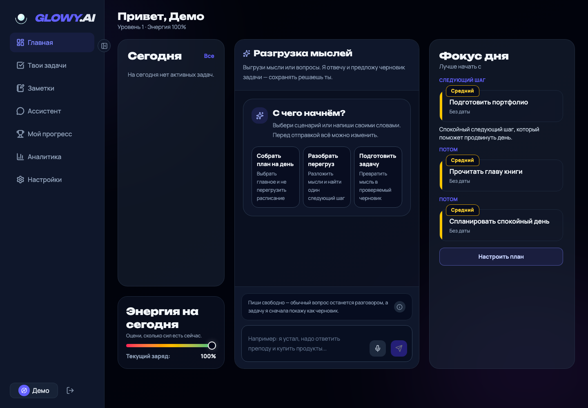

# Glowy AI

Русскоязычный персональный планировщик: задачи, заметки и спокойный план дня с учётом энергии. AI помогает структурировать мысли и предлагает редактируемые черновики; пользователь подтверждает изменения сам.

[Открыть приложение](https://glowy-ai.ru) · [Telegram](https://t.me/glowy_bot)

> Активная продуктовая разработка остановлена. Проект сохраняется как portfolio case study; продолжаются исправления безопасности и подготовка demo-размещения. Прежняя Timeweb-инфраструктура недоступна, поэтому ссылки могут не работать до переноса.

## Проблема и возможности

Планирование легко превращается в ещё один источник давления. Glowy объединяет сбор задач и мыслей, выбор посильного следующего шага и прогресс без обязательных жёстких норм.

- Задачи и подзадачи: даты, приоритеты, сортировка, группировка и массовые действия.
- Dashboard: план дня, текущая энергия и фокус.
- AI-ассистент: структурирование текста, декомпозиция и поддерживающие ответы.
- Заметки, уровни, привычки и аналитика завершённых задач.
- Offline-работа с задачами и восстановление синхронизации.
- Гостевой режим и адаптивный интерфейс; Telegram Mini App с привязкой аккаунта.
- Интеграция ЮKassa сохранена в коде и тестах; новые покупки отключены.

## Скриншоты

Локальный гостевой режим, только вымышленные задачи:




## Мой вклад

Автор самостоятельно вёл проект как единственный разработчик и принимал продуктовые решения: от идеи и интерфейса до API, базы, интеграций, тестов и размещения. Разработка была AI-assisted: инструменты генерации кода использовались активно. Это описание не утверждает, что каждая строка написана вручную или что все решения создавались без помощи AI.

## Инженерные задачи

- React + TypeScript: адаптивные экраны, взаимодействия и типизированные API-клиенты.
- Zustand для клиентского состояния; TanStack Query для части серверных данных.
- IndexedDB: локальный снимок задач, очередь изменений, повторная отправка после восстановления сети.
- Express REST API и общие Zod-контракты в `packages/contracts`.
- HttpOnly cookie auth: bcrypt, ограниченные JWT-сессии, отзыв при logout, CORS/CSRF и rate limiting.
- PostgreSQL + Prisma: связи данных, миграции, проверяемый TLS и контроль доступа по владельцу.
- AI: server-side DeepSeek, fallback GigaChat, валидация ответа, резервирование квоты и возврат при ошибке.
- ЮKassa: checkout, повторная серверная проверка суммы/валюты/metadata и идемпотентный webhook. Подтверждённая выручка не заявляется.
- Telegram Mini App: проверка подписанных init data, ограниченный срок запуска, привязка и отзыв сессии.
- Исторический deployment на Timeweb; локально подготовлен переход на Vercel + Render + внешнюю PostgreSQL.

## Архитектура

Браузер / Telegram Mini App → React → REST API → Express → Prisma → PostgreSQL.
AI- и платёжные провайдеры доступны только backend. Offline-очередь находится на устройстве; AI не изменяет данные автоматически.

```text
src/                  интерфейс, API-клиенты, Zustand, offline
backend/              Express, services, middleware, Prisma
packages/contracts/   общие runtime-схемы и типы
ai-proxy/             optional proxy, не требуется в direct-режиме
docs/                 архитектура, дизайн и безопасный запуск
openspec/             текущие спецификации и изменения
```

## Технологии

React 19, TypeScript, Vite, Tailwind CSS, Radix UI, Zustand, TanStack Query,
Axios, IndexedDB, Node.js, Express, PostgreSQL, Prisma, Zod, bcrypt,
Vitest, Testing Library, Playwright, Node test runner, Storybook и GitHub Actions.

## Безопасный локальный запуск

Требуются Node.js 22.22+ и локальный PostgreSQL. Не используйте production credentials.

```sh
npm ci
npm --prefix backend ci
cp .env.example .env.local
cp backend/.env.example backend/.env
npm run build:backend
```

В `backend/.env` задайте локальную `DATABASE_URL`, `DATABASE_TLS_MODE=local`,
`NODE_ENV=development`, случайный `JWT_SECRET` и разрешённый localhost origin.
Платежи, регистрацию и Telegram worker оставьте выключенными. Новая база остаётся пустой,
без seed и тестовых аккаунтов. Яндекс Метрика не подключается. Примеры переменных — в env templates;
секреты никогда не передаются через `VITE_*`.

Применение миграций разрешено **только к вашей новой локальной базе**:

```sh
npm --prefix backend run migrate:deploy
npm --prefix backend run serve
```

В другом терминале: `npm run dev`. На странице входа нажмите «Открыть демо без
регистрации»: база, AI-ключи и оплата не нужны. Доступны локальные задачи, подзадачи,
заметки и их связи с задачами, привычки, прогресс, не-AI аналитика, аватар и обычные
настройки. AI в демо выключен; регистрация, оплата, Telegram и облачная синхронизация
не открываются. Данные остаются только в этом браузере и не являются резервной копией.
Инструкции: [demo setup](docs/demo-hosting.md).
Локальный backend запускается с компиляцией; после изменения исходников перезапустите
его. Optional autoreloader исключён из-за advisory его зависимости.

## Тестирование

```sh
npm run contracts:test
npm run typecheck
npm run lint
npm test
npm --prefix backend test
npm run build
npm run build:backend
npm run test:e2e
npm run test:deployment
npm run test:foundations
npm --prefix ai-proxy test
```

Backend HTTP-тесты используют изолированные зависимости, а не production-базу.
Playwright требует установленного браузера. Проверки не заменяют smoke нового размещения.

## Статус и лицензия

Maintenance / portfolio. Бесплатные сервисы могут засыпать; demo не следует использовать
как постоянное хранилище важных или чувствительных данных. Живые AI-вызовы могут иметь отдельную стоимость.

Лицензия: [All Rights Reserved](LICENSE). Публичный репозиторий не означает разрешение
копировать или использовать исходники. Коммерческие результаты и аудитория не заявляются.

Подробнее: [архитектура](docs/architecture.md), [дизайн-система](docs/design-system.md),
[размещение](docs/demo-hosting.md).
