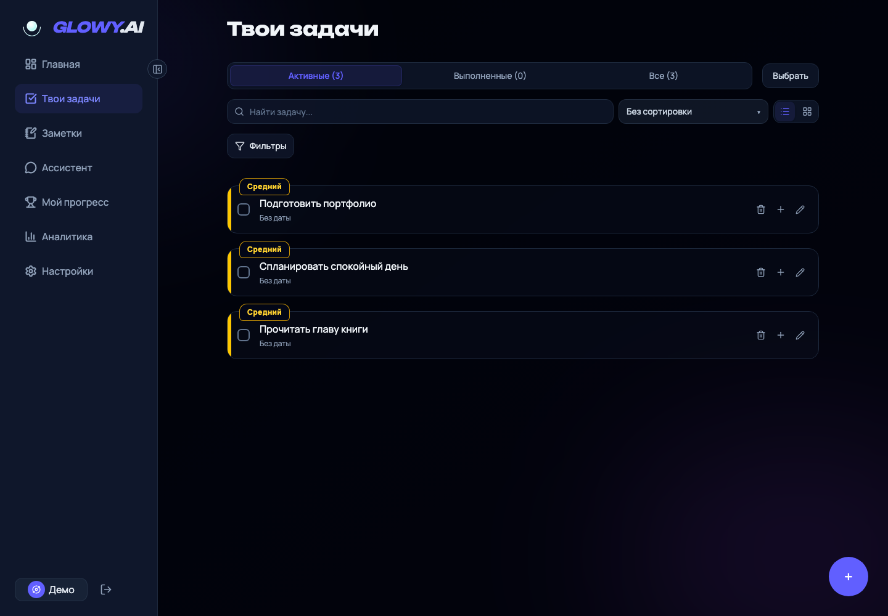

# Glowy AI

Русскоязычный персональный планировщик: задачи, заметки и спокойный план дня с учётом энергии. AI помогает структурировать мысли и предлагает редактируемые черновики; пользователь подтверждает изменения сам.

[Открыть приложение](https://glowy-ai.ru) · [Telegram](https://t.me/glowy_bot)

## Проблема и возможности

Планирование легко превращается в ещё один источник давления. Glowy объединяет сбор задач и мыслей, выбор посильного следующего шага и прогресс без обязательных жёстких норм.

- Задачи и подзадачи: даты, приоритеты, сортировка, группировка и массовые действия.
- Главная страница: план дня, текущая энергия и фокус.
- AI-ассистент: структурирование текста, декомпозиция и поддерживающие ответы.
- Заметки, уровни, привычки и аналитика завершённых задач.
- Работа с задачами без интернета и восстановление синхронизации.
- Гостевой режим и адаптивный интерфейс; мини-приложение Telegram с привязкой аккаунта.
- Интеграция ЮKassa сохранена в коде и тестах; новые покупки отключены.

## Скриншоты

Локальный гостевой режим, только вымышленные задачи:




## Инженерные задачи

- React + TypeScript: адаптивные экраны, взаимодействия и типизированные API-клиенты.
- Zustand для клиентского состояния; TanStack Query для части серверных данных.
- IndexedDB: локальный снимок задач, очередь изменений, повторная отправка после восстановления сети.
- Express REST API и общие Zod-контракты в `packages/contracts`.
- Авторизация через HttpOnly cookie: bcrypt, ограниченный срок JWT-сессий, их отзыв при выходе, CORS/CSRF и ограничение частоты запросов.
- PostgreSQL + Prisma: связи данных, миграции, проверяемый TLS и контроль доступа по владельцу.
- AI: серверные запросы к DeepSeek, резервный провайдер GigaChat, проверка ответа, резервирование квоты и её возврат при ошибке.
- ЮKassa: оформление платежа, повторная серверная проверка суммы, валюты и дополнительных данных. Повторное уведомление не активирует тариф заново. Подтверждённая выручка не заявляется.
- Мини-приложение Telegram: проверка подписи данных запуска, ограниченный срок сессии, привязка аккаунта и отзыв доступа.
- Размещение: клиентская часть на Vercel, серверная — на Render, PostgreSQL — в Neon.

## Архитектура

Браузер / мини-приложение Telegram → React → REST API → Express → Prisma → PostgreSQL.
AI- и платёжные провайдеры доступны только серверной части. Очередь изменений для работы без интернета находится на устройстве; AI не изменяет данные автоматически.

```text
src/                  интерфейс, API-клиенты, Zustand, работа без интернета
backend/              Express, сервисы, промежуточные обработчики, Prisma
packages/contracts/   общие схемы проверки данных и типы
ai-proxy/             необязательный прокси для AI-провайдера
docs/                 архитектура, дизайн и безопасный запуск
```

## Технологии

React 19, TypeScript, Vite, Tailwind CSS, Radix UI, Zustand, TanStack Query,
Axios, IndexedDB, Node.js, Express, PostgreSQL, Prisma, Zod, bcrypt,
Vitest, Testing Library, Playwright, встроенный модуль тестирования Node.js, Storybook и GitHub Actions.

## Безопасный локальный запуск

Требуются Node.js 22.22+ и локальный PostgreSQL. Не используйте учётные данные рабочего сервера.

```sh
npm ci
npm --prefix backend ci
cp .env.example .env.local
cp backend/.env.example backend/.env
npm run build:backend
```

В `backend/.env` задайте локальную `DATABASE_URL`, `DATABASE_TLS_MODE=local`,
`NODE_ENV=development`, случайный `JWT_SECRET` и разрешённый адрес локального сайта.
Платежи, регистрацию и фоновый обработчик Telegram оставьте выключенными. Новая база остаётся пустой,
без начального заполнения и тестовых аккаунтов. Яндекс Метрика не подключается. Примеры переменных — в файлах `.env.example`;
секреты никогда не передаются через `VITE_*`.

Применение миграций разрешено **только к вашей новой локальной базе**:

```sh
npm --prefix backend run migrate:deploy
npm --prefix backend run serve
```

В другом терминале: `npm run dev`. На странице входа нажмите «Открыть демо без
регистрации»: база, AI-ключи и оплата не нужны. Доступны локальные задачи, подзадачи,
заметки и их связи с задачами, привычки, прогресс, не-AI аналитика, аватар и обычные
настройки. AI в демо выключен; регистрация, оплата, Telegram и облачная синхронизация
не открываются. Данные остаются только в этом браузере и не являются резервной копией.
Инструкции: [запуск и размещение](docs/demo-hosting.md).
Серверная часть запускается с компиляцией; после изменения исходников перезапустите её.
Автоматическая перезагрузка сервера не используется из-за уязвимости в зависимости соответствующего инструмента.

## Тестирование

```sh
npm run contracts:test
npm run typecheck
npm run lint
npm test
npm --prefix backend test
npm run build
npm run build:backend
npm run test:e2e
npm run test:deployment
npm run test:foundations
npm --prefix ai-proxy test
```

HTTP-тесты серверной части используют изолированные зависимости, а не рабочую базу.
Playwright требует установленного браузера. После размещения отдельно проверьте доступность сайта и основные сценарии.

## Размещение и лицензия

Клиентская часть размещена на Vercel, серверная — на Render, база данных — в Neon.
Бесплатные сервисы могут засыпать; демо не следует использовать
как постоянное хранилище важных или чувствительных данных. Живые AI-вызовы могут иметь отдельную стоимость.

Лицензия: [все права защищены](LICENSE). Публичный репозиторий не означает разрешение
копировать или использовать исходники. Коммерческие результаты и аудитория не заявляются.

Подробнее: [архитектура](docs/architecture.md), [дизайн-система](docs/design-system.md),
[размещение](docs/demo-hosting.md).
